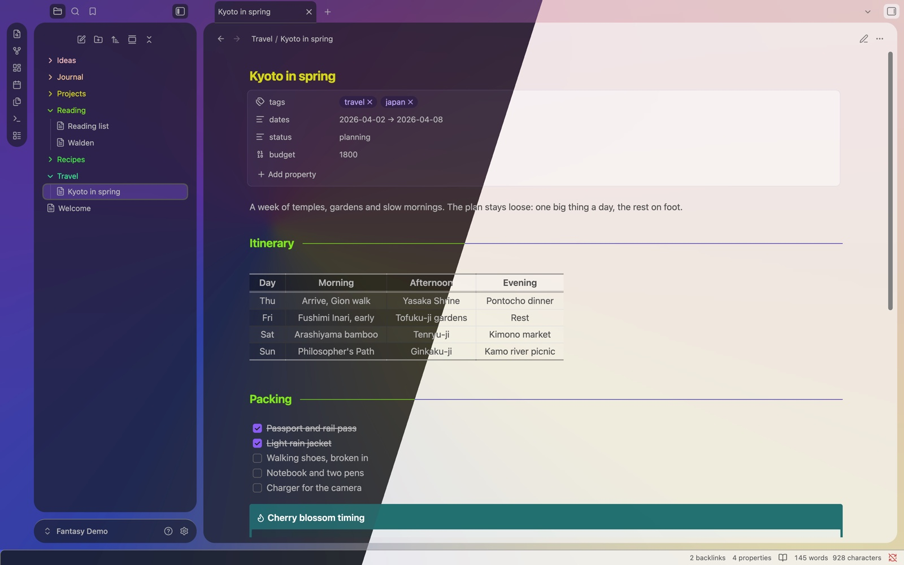
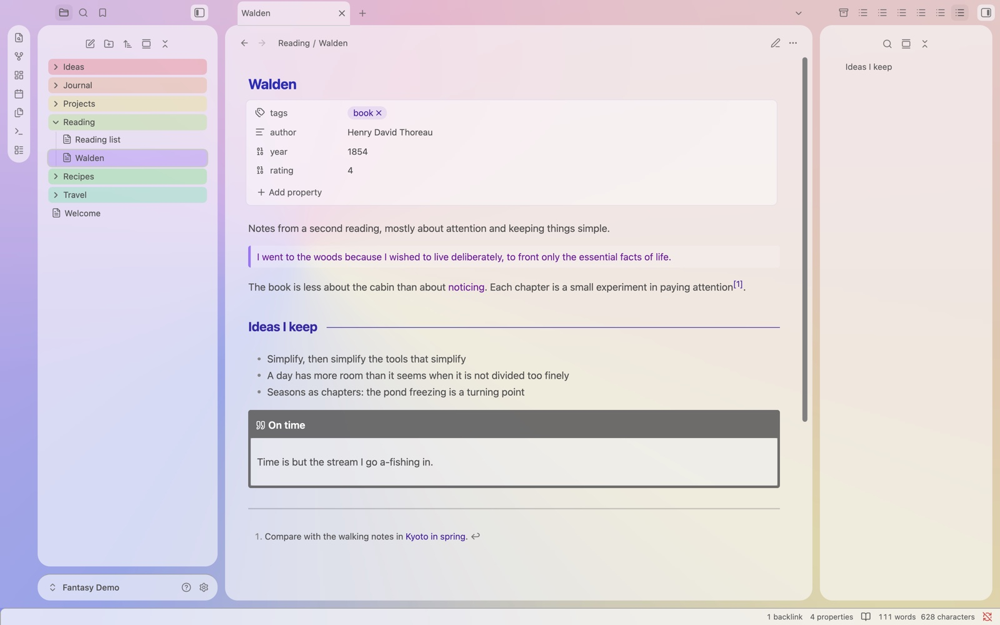
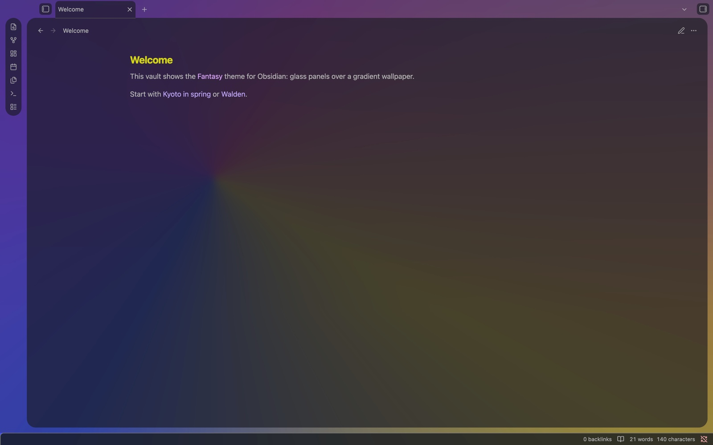

# Fantasy

**Glass panels over your wallpaper.** A glassy Obsidian theme: translucent cards over a colorful gradient, in dark and light mode.

## Features

- **Glass panels** over a built-in gradient wallpaper (Silk, tinted by the palette). No network: everything is in `theme.css`.
- **Card layout**: sidebars, ribbon and editor float as rounded glass cards, with one even gap everywhere.
- **Same look with or without** Obsidian's translucent window (Settings → Appearance).
- **Readable glass**: tuned so text stays readable over the panels.
- **Rainbow folders** in the file explorer and bookmarks, and per-file-type icons.
- Dark and light mode.

## Screenshots

| Light mode, outline open | The wallpaper behind the glass |
| --- | --- |
|  |  |

## Settings

Fantasy has no Style Settings options. It looks complete on its own: the Graphite palette, the Silk wallpaper and the card layout.

Settings come with a companion plugin, **[Fantasy Easel](https://github.com/especialkim/obsidian-fantasy-easel)** (install it from GitHub until it is listed in Community plugins):

> - six palettes (Graphite, Sky, Ocean, Emerald, Mystic, Orchid) and a theme accent
> - card layout on / off
> - a style panel: glass opacity, blur and brightness per mode, card gap and corners, note width, heading size, paragraph spacing
> - more wallpapers, still and moving, and your own pictures
> - plugin styles (Excalidraw, Dataview, Kanban), each part on or off

## Requirements

- Obsidian 1.14 or later.

## Credits

- Inspired by [AnuPpuccin](https://github.com/AnubisNekhet/anuppuccin) by AnubisNekhet. Fantasy contains no AnuPpuccin code.
- File explorer icons from [Lucide](https://lucide.dev) (ISC License). See [LICENSE](./LICENSE).

## Support

If you enjoy it, you can [buy me a coffee](https://buymeacoffee.com/yongminkiml). ☕️

## License

[MIT](./LICENSE) © 2026 YongMin Kim
